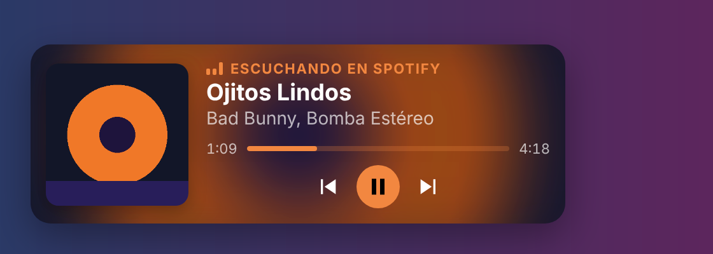

# 🎵 OBS Now Playing

[English](README.md) · **Español**

Muestra en OBS la canción que suena en tu computador: carátula, título, artista y barra de progreso, con los **colores de la carátula**, y con **botones para cambiar de canción**. Funciona en **Windows y macOS** con la app de **Spotify**, **YouTube Music** o Spotify en el navegador, **Apple Music** y cualquier reproductor que el sistema reconozca. Sin cuentas, sin claves de API y sin extensiones.



## ¿Plugin o app?

Hay dos formas de usarlo, con los mismos lectores por dentro:

- **Plugin de OBS** (recomendado): agrega la fuente **Now Playing (música)** y el dock **Música** directamente dentro de OBS, configurables desde sus Propiedades. Ver abajo y **[obs-plugin/](obs-plugin/)**.
- **App**: corre aparte y sirve el overlay por URL. Sirve también para otros programas de streaming, o para usar la Fuente de texto.

## Plugin de OBS

- **Fuente "Now Playing (música)"**: diseño horizontal o vertical (el tamaño se ajusta solo), tema claro/oscuro, estilo sólido o **cristal** con opacidad, carátula normal/grande/oculta, tu **logo** cuando no hay carátula, y **video** de YouTube Music / YouTube (sin sonido y sincronizado) en vez de la carátula.
- **Dock "Música"**: carátula y botones **anterior / pausa / siguiente**, dentro de OBS y fuera del stream.
- **Crear canal de música** (en las Propiedades de la fuente): un canal en el Mezclador de audio solo con el sonido del reproductor, para manejar su volumen aparte.
- **Actualizaciones** con un aviso al abrir OBS.

### Instalar el plugin

Descarga `obs-now-playing-plugin-<versión>-macos.zip` o `-windows-x64.zip` desde **[Releases](../../releases/latest)** y cierra OBS antes.

- **macOS** (OBS 31+): descomprime, copia `obs-now-playing.plugin` a `~/Library/Application Support/obs-studio/plugins/` y en la Terminal:
  `xattr -cr ~/Library/Application\ Support/obs-studio/plugins/obs-now-playing.plugin`
- **Windows** (OBS 31+): descomprime en `C:\ProgramData\obs-studio\plugins\`.

Después: **Fuentes → + → Now Playing (música)** y **Docks → Música**. Detalles en **[obs-plugin/README.md](obs-plugin/README.md)**.

## App

### Cómo funciona

Windows y macOS ya saben qué está sonando: es lo que muestran el control de volumen de Windows y el "Ahora suena" del Centro de control del Mac. La app lee esa información y la sirve como una página que OBS muestra con una **Fuente de navegador**.

```
Spotify / YouTube Music / Apple Music…
        │  (el reproductor avisa al sistema)
        ▼
Windows: controles multimedia (SMTC) ── PowerShell ─┐
macOS:   "Ahora suena" (MediaRemote) ── osascript ──┼─► app local (127.0.0.1:8787) ─► Fuente de navegador en OBS
Plan B:  script de Tampermonkey en el navegador ────┘                              └─► now-playing.txt (Fuente de texto)
```

La idea de leer los controles multimedia del sistema viene de [SMTC Bridge](https://github.com/nuttylmao/smtc-bridge) (solo Windows); esta app la lleva también a macOS, trae su propio overlay y no expone lo que escuchas a otras páginas web.

### 1. Instalar la app

Descarga el instalador de la app desde **[Releases](../../releases/latest)**. No necesitas Node.js ni la terminal: cada instalador trae todo.

#### Windows 10/11

1. Descarga `OBS-Now-Playing-Setup-<versión>.exe` y ábrelo.
2. Si sale **"Windows protegió su PC"**, pulsa **Más información → Ejecutar de todas formas** (pasa con toda app sin certificado de firma pagado).
3. Sigue el asistente. Por defecto la app **arranca con Windows** en segundo plano, para que el overlay ya esté listo al abrir OBS.

Se instala en tu usuario, sin permisos de administrador. Para quitarla: **Configuración → Aplicaciones → OBS Now Playing → Desinstalar**.

#### macOS 11 o superior

1. Descarga el zip de tu Mac (menú  → **Acerca de esta Mac**):
   - **Chip Apple M1/M2/M3/M4…** → `OBS-Now-Playing-<versión>-mac-apple.zip`
   - **Procesador Intel** → `OBS-Now-Playing-<versión>-mac-intel.zip`
2. Descomprímelo y **arrastra `OBS Now Playing` a Aplicaciones**.
3. Ábrela. La primera vez macOS la bloquea porque no está firmada con una cuenta de desarrollador de Apple:
   - Pulsa **OK / Listo** en el aviso.
   - Ve a **Ajustes del Sistema → Privacidad y seguridad**, baja hasta *"Se bloqueó OBS Now Playing"* y pulsa **Abrir igualmente**. Confirma con tu contraseña.
   - Solo pasa esa vez.

   Si en vez de eso dice **"está dañado y no puede abrirse"** (pasa con algunas versiones de macOS con apps sin firma de Apple), no está dañado: abre la Terminal y pega
   `xattr -cr "/Applications/OBS Now Playing.app" && open "/Applications/OBS Now Playing.app"`
4. Para que arranque sola: **Ajustes del Sistema → General → Ítems de inicio → +** y elige la app.

La app no tiene ventana ni ícono en el Dock: al abrirla se abre su **panel** en el navegador. Si cierras esa pestaña, sigue funcionando; abre la app otra vez para volver al panel.

### 2. El panel

En **http://127.0.0.1:8787/** ves qué está sonando, si el lector del sistema funciona, las **apps detectadas** (puedes ocultar las que no quieras, por ejemplo el navegador si también ves videos), la URL para OBS y el botón **Cerrar OBS Now Playing**.

### 3. Añadirlo a OBS

1. En **Fuentes**, pulsa **+** y elige **Navegador**.
2. URL: `http://127.0.0.1:8787/overlay`
3. Ancho `640`, alto `200` (o el tamaño de tu lienzo, si usas `pos=`).

Opciones que puedes añadir a la URL (se combinan con `&`):

| Parámetro | Efecto |
|---|---|
| `theme=light` | Tema claro |
| `pos=br` | Esquina: `bl` (abajo izq., por defecto), `br`, `tl`, `tr` |
| `art=0` / `art=big` | Sin carátula / carátula grande |
| `colors=0` | No usar los colores de la carátula (usa el color de cada app) |
| `blur=1` | Fondo de la tarjeta con la carátula difuminada |
| `controls=1` | Botones anterior / pausa / siguiente **en el overlay** (se ven en el stream; en OBS se pulsan con clic derecho → **Interactuar**) |
| `progress=0` | Sin barra de progreso |
| `label=0` | Sin la línea "Escuchando en …" |
| `width=480` | Ancho de la tarjeta en px |
| `accent=ff00aa` | Color de acento fijo (por defecto, el de la carátula) |
| `preview=1` | Canción de ejemplo cuando no suena nada (para ubicarla) |

Ejemplo: `http://127.0.0.1:8787/overlay?pos=br&art=big&blur=1`

Por defecto el overlay toma de la carátula su color más vivo para los acentos (barra, etiqueta) y un tono oscuro del color dominante para el fondo, y los cambia con una transición suave en cada canción.

### Botones para cambiar de canción

Lo recomendado es un **dock** de OBS: un panel con la carátula y los botones anterior / pausa / siguiente que vive dentro de OBS, junto a tus escenas, y **no sale en el stream**.

1. En OBS: **Docks → Docks de navegador personalizados**.
2. Nombre: `Música`; URL: `http://127.0.0.1:8787/controls`. Aplica y acomoda el panel donde quieras.

Los botones controlan la app que muestra el overlay: en Windows con los controles multimedia del sistema, en macOS con los mismos comandos de las teclas de música, y con el plan B pulsando los botones de la página de YouTube Music o Spotify (reinstala el script desde el panel si lo tenías de antes).

**¿Prefieres solo texto?** Usa una **Fuente de texto** con "Leer desde archivo" apuntando a `now-playing.txt` (el panel muestra la ruta exacta y tiene un botón **Abrir carpeta**). El formato se cambia en `textFormat` de `config.json`, en esa misma carpeta.

### Plan B: script para el navegador

Si el lector del sistema no funciona en tu equipo (el panel lo dice), instala [Tampermonkey](https://www.tampermonkey.net/) y pulsa **Instalar script** en el panel. Lee YouTube Music y Spotify web directamente desde la pestaña. En Chrome/Edge recientes hay que activar el **Modo desarrollador** en `chrome://extensions` (o "Permitir scripts de usuario" en los detalles de la extensión).

## Problemas frecuentes

- **No aparece nada en OBS:** abre el panel (http://127.0.0.1:8787/). Si no carga, la app está cerrada: ábrela. Prueba también la URL con `?preview=1`.
- **Sale un video de YouTube en vez de la música:** en el panel, oculta el navegador en **Apps detectadas**.
- **El navegador sale como "Escuchando ahora" y no como "YouTube Music":** el sistema solo sabe que suena en Chrome/Edge, no qué página. Si instalas YouTube Music como app (menú del navegador → *Instalar YouTube Music*), sale con su nombre y color.
- **El puerto 8787 está ocupado por otro programa:** cambia `port` en `config.json` (carpeta de datos) **y** `ENDPOINT` en el script de Tampermonkey si lo usas.
- **Plugin:** si el dock dice que el lector del sistema no funciona, el mensaje dice por qué; el registro de OBS (**Ayuda → Archivos de registro**) tiene las líneas `[obs-now-playing]`.
- **Algo falla y no sé qué:** el registro está en `log.txt`, en la carpeta de datos:
  - Windows: `%APPDATA%\OBS Now Playing`
  - macOS: `~/Library/Application Support/OBS Now Playing`

## Privacidad

Todo corre en tu computador y nada sale a internet. El servidor solo escucha en `127.0.0.1`, rechaza peticiones con otro `Host` y no manda cabeceras CORS, así que las páginas web que visites no pueden leer lo que escuchas.

El plugin tampoco usa servidores propios. Solo se conecta a internet para buscar actualizaciones en GitHub, para buscar la carátula en el catálogo público de Apple cuando el reproductor no la entrega (manda el nombre de la canción y el artista) y, si eliges el modo video, para cargar el reproductor de YouTube.

## Para desarrolladores

- Correr desde el código: `npm start` (Node 18+). Usa la misma carpeta de datos que la app instalada; `OBS_NOW_PLAYING_DATA=/otra/ruta` la cambia.
- Lectores del sistema: `media/windows.ps1` (Windows PowerShell 5.1 + WinRT) y `media/macos.js` (JavaScript for Automation). Ambos escriben una línea JSON por segundo; el protocolo está al inicio de `media/windows.ps1`. Los botones llegan a Windows por el archivo `.command` de la carpeta de datos, a macOS con `osascript media/macos.js command next` y al userscript en la respuesta de su latido. Para probar sin Windows ni Mac, `OBS_NOW_PLAYING_HELPER=lector-falso.js` hace que el servidor use un script de Node que escriba ese mismo protocolo.
- En macOS 15.4+ Apple solo deja leer "Ahora suena" a programas del sistema; por eso el lector corre en `osascript` y no en Node.
- Generar los instaladores: `./build/build.sh [all|windows|mac]` (requiere `python3` con Pillow; Windows: `makensis`/NSIS; Mac: mejor en un Mac, que es el único que firma la app entera, o en Linux con `clang` y `lld` sin firmar). Descarga el Node.js oficial, verifica su SHA-256 y deja todo en `dist/`. El flujo **Release** de GitHub Actions hace lo mismo y sube los archivos a Releases.
- El plugin se compila con CMake desde `obs-plugin/` (Xcode en macOS, Visual Studio 2022 en Windows); ver [obs-plugin/README.md](obs-plugin/README.md).
- La app de Mac usa el binario oficial de Node sin modificar (firmado y notarizado por Node.js); lo que macOS no puede verificar es el paquete `.app`. Quitar el aviso del todo requiere firmar y notarizar con una cuenta de Apple Developer (USD 99/año). En Windows, el equivalente es un certificado de firma de código.

## Licencia

MIT — ver [LICENSE](LICENSE). El plugin de OBS es GPL-2.0 o posterior (como todo plugin que enlaza con libobs), ver `obs-plugin/LICENSE`.
